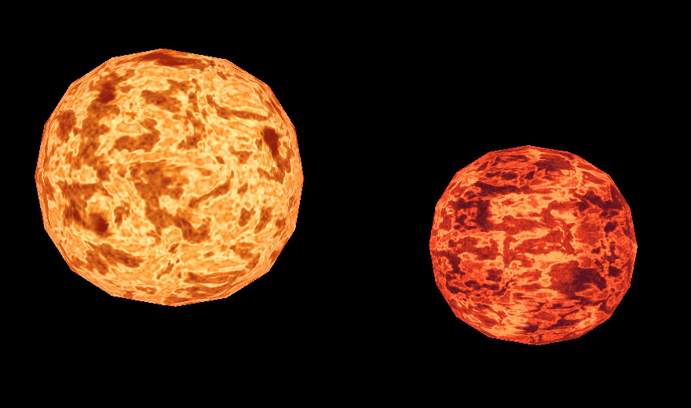
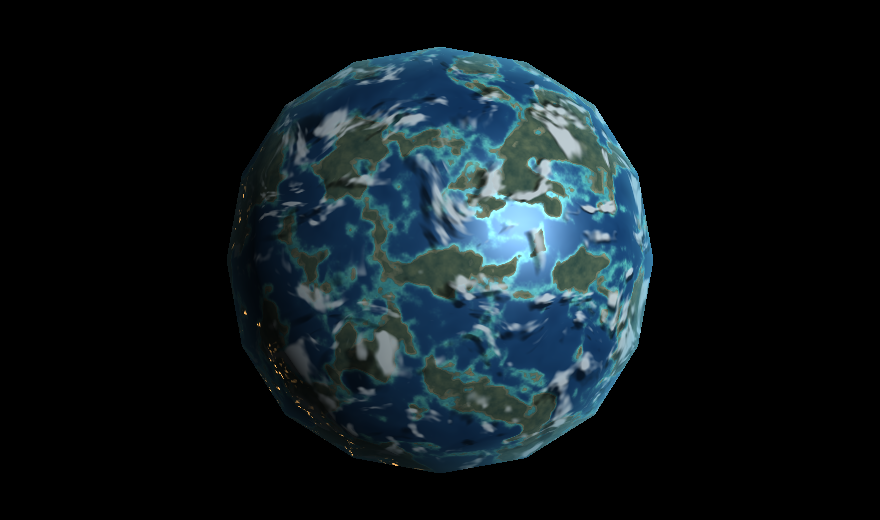
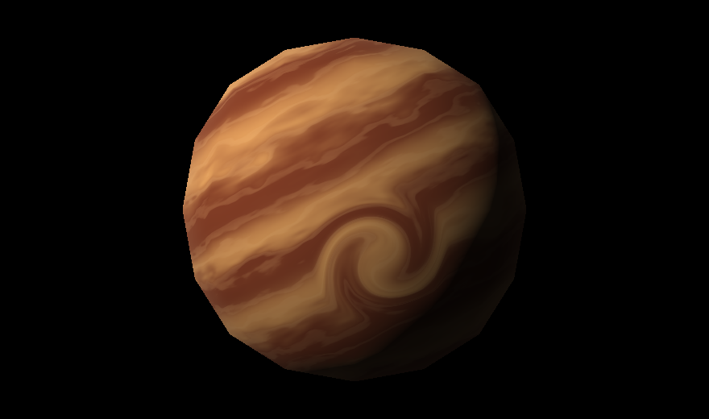
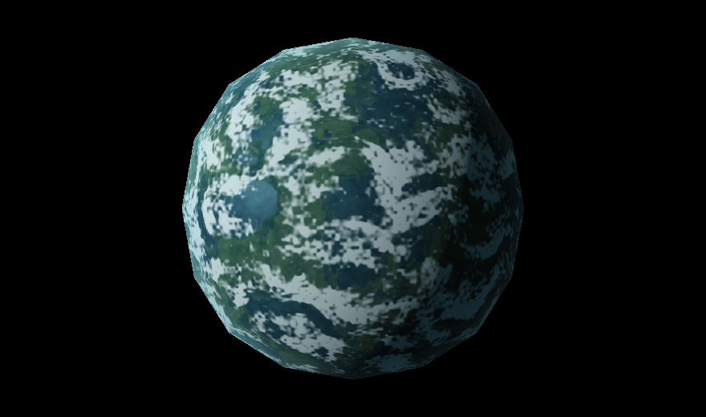
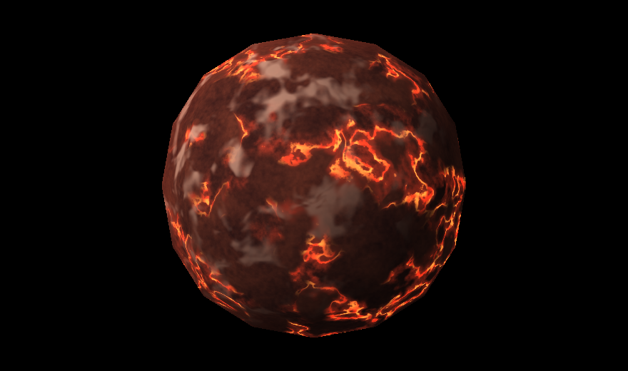

Universidad del Valle de Guatemala

Facultad de Ingeniería

Gráficas por Computadora

# Laboratorio 6: planetas y estrellas con shaders

Juan Francisco Orozco Mijangos (24647)

## Descripción del proyecto

En este laboratorio recreamos los dos soles de Tatooine, Scarif, Bespin, Naboo y Mustafar para practicar cómo se puede cambiar por completo la apariencia de un objeto con un shader. Cargamos una sola vez la esfera que nos dieron y reutilizamos sus 98 vértices y 192 triángulos para los seis cuerpos. En la vista de Tatooine dibujamos la malla dos veces con posiciones, escalas y materiales distintos. Los planetas se ven uno a la vez en un visor con fondo negro y un rótulo que indica su clasificación. Tomamos las imágenes de referencia como guía para las paletas, la iluminación y los patrones de cada material.

Reconstruimos el pipeline en Rust siguiendo el material de clase sobre el rasterizador y el dibujo de múltiples modelos. Primero pasamos cada vértice por las transformaciones de modelo y vista y lo proyectamos a pantalla. Después usamos coordenadas baricéntricas y un búfer de profundidad para decidir qué fragmentos son visibles. En cada fragmento interpolamos la posición local con corrección de perspectiva y obtenemos una normal radial. Con ella, la luz y el tiempo calculamos el color usando ruido tridimensional, máscaras y funciones matemáticas. Toda esa parte corre en CPU. Raylib abre la ventana y muestra los píxeles que ya calculamos. [Esfera](assets/sphere.obj) · [Pipeline](src/pipeline.rs) · [Shaders](src/shaders.rs)

## Compilación y ejecución

Se necesita Rust estable con Cargo, CMake y un compilador C/C++ con Clang. En macOS, si hacen falta las herramientas de línea de comandos de Xcode, ejecuta `xcode-select --install` y espera a que termine. Con Homebrew se puede instalar CMake con `brew install cmake`. Comprueba que `cargo --version`, `cmake --version` y `clang --version` respondan antes de compilar.

Abre Terminal en la carpeta del repositorio, donde están `Cargo.toml` y este README, y ejecuta:

```sh
cargo build --release --locked
cargo run --release --locked
```

Al abrirse el visor verás los dos soles. Haz clic dentro de la ventana si el teclado sigue escribiendo en Terminal. Pulsa `H` para abrir o cerrar la ayuda en pantalla.

| Tecla | Acción |
| --- | --- |
| `1` | Tatooine, dos estrellas con plasma animado |
| `2` | Scarif, planeta rocoso con nubes bajas, sombras y luces nocturnas |
| `3` | Bespin, gigante gaseoso con corrientes de viento y una tormenta |
| `4` | Naboo, planeta rocoso con frentes de nubes altas |
| `5` | Mustafar, planeta rocoso con ríos de lava y ceniza |
| Mantener `←` / `→` | Girar la iluminación del planeta. Los soles tienen brillo propio. |
| Mantener `↑` / `↓` | Subir o bajar el efecto de la vista activa. El visor indica cuál se ajusta y muestra su porcentaje. |
| Espacio | Pausar o reanudar el tiempo del material. La luz y el ajuste del efecto siguen disponibles. |
| `S` | En Scarif, alternar las sombras manteniendo las nubes visibles |
| `R` | Restaurar el reloj, la luz y el efecto de la vista activa. En Scarif también restablece sus sombras. |
| `H` | Mostrar u ocultar los controles detallados |
| Esc | Cerrar el visor |

### Cómo comprobar los efectos

1. **Scarif.** Pulsa `2` y `R`. Mantén `↑` para aumentar la cobertura. Pulsa Espacio para congelar el patrón y cambia la luz con `←` o `→`. En el lado iluminado busca el reflejo sobre el agua. En el lado nocturno busca los puntos ámbar de la costa. Pulsa `S` para comparar las sombras con la misma luz y las mismas nubes.
2. **Bespin y Naboo.** Pulsa `3` y observa cómo se desplazan las vetas cobrizas a través de las bandas curvadas. Usa `↑` para destacar la turbulencia. Pulsa `4` y cambia la cobertura para separar visualmente las nubes altas del terreno fijo.
3. **Tatooine y Mustafar.** Pulsa `1` o `5` y observa los filamentos del plasma o el brillo que recorre las grietas. Pulsa Espacio para congelarlos y usa `↑` y `↓` para apreciar el cambio de intensidad a tiempo fijo.

La interfaz usa Lato Medium para los títulos y la ayuda. [Licencia de la tipografía](assets/fonts/OFL-Lato.txt)

## Cuerpos celestes

### Los dos soles de Tatooine

**Izquierda, sol ámbar.** Combinamos gránulos finos con ruido de menor frecuencia para distribuir manchas oscuras. Otro campo de ruido deforma el plasma y el tiempo hace que cambie la red de filamentos dorados. `PLASMA_SPEED` cambia la velocidad de esa deformación. El umbral de `spots` controla cuántas manchas aparecen.

**Derecha, sol rojo.** Estiramos el patrón de ruido en latitud para crear vetas más largas y usamos arcos rojizos de gran escala para separar regiones calientes. El vector de frecuencia en `storm` controla cuánto se estiran las vetas.

En `tatoo_i` y `tatoo_ii`, el tiempo modifica las coordenadas del ruido de cada material. Ambos soles emiten su propio color y sus filamentos se mueven con la geometría inmóvil. [Código](src/shaders.rs) · [Animación de los soles](docs/soles.mp4)



### Scarif

En `scarif` usamos un campo de altura para separar los arrecifes turquesa, el océano azul profundo y las islas con costas irregulares. El umbral de `land` mueve la costa y el de `shallow` cambia el ancho de los arrecifes. [Código](src/shaders.rs)

- **Día y noche.** En `coastal_lights` combinamos una máscara de costa con la dirección de la luz para encender los asentamientos del lado nocturno. `NIGHT_LIGHT_STRENGTH` cambia su brillo. [Barrido de luz](docs/scarif-luz.mp4)
- **Agua y tierra.** En `water_reflection` calculamos el brillo especular y en `scarif` lo limitamos al agua. La tierra conserva su respuesta difusa. Subir `WATER_SPECULAR_POWER` hace el reflejo más estrecho. [Barrido de luz](docs/scarif-luz.mp4)
- **Nubes.** En `cloud_mask` desplazamos las coordenadas del ruido sin mover las islas. `CLOUD_SPEED` cambia la velocidad y las flechas verticales ajustan la cobertura. [Movimiento con luz fija](docs/scarif-nubes.mp4)
- **Sombras de nubes.** En `cloud_shadow` seguimos la dirección de la luz hasta una altura virtual y evaluamos allí la misma máscara de nubes para atenuar la luz directa. `CLOUD_HEIGHT` cambia la separación entre la nube y su sombra cuando la luz llega de lado. El video muestra las sombras a la izquierda y la misma escena con las sombras desactivadas a la derecha. [Comparación con nubes fijas](docs/scarif-sombras.mp4)



### Bespin

En `bespin` mezclamos ondas inclinadas y ruido para generar bandas de cobre, ámbar y arena. Cerca de la tormenta, `bespin_vortex` rota las coordenadas antes de evaluar las bandas. El giro disminuye con la distancia al centro y la tormenta curva las franjas. Las vetas de gas viajan sobre las bandas con el tiempo. `VORTEX_RADIUS` cambia el tamaño de la zona afectada y `BESPIN_WIND_SPEED` regula el desplazamiento. [Código](src/shaders.rs) · [Video de las corrientes](docs/bespin-vientos.mp4)



### Naboo

En `naboo` combinamos ruido a varias escalas para separar lagos azul verdoso, llanuras y franjas de agua que atraviesan el terreno. Sobre esa superficie mezclamos una máscara de nubes altas que gira en sentido contrario al de Scarif. El umbral de `land` cambia la proporción de agua y tierra. `NABOO_CLOUD_SPEED` controla el movimiento de las nubes. [Código](src/shaders.rs) · [Video de los frentes nubosos](docs/naboo-nubes.mp4)



### Mustafar

En `mustafar` generamos una corteza de basalto rojizo con ruido a varias escalas. Un contorno del campo de altura delimita las grietas y una segunda máscara concentra la lava en las zonas volcánicas. El brillo de la lava se desplaza dentro de las grietas incluso en el lado nocturno, mientras una capa tenue de ceniza pasa sobre la corteza. `LAVA_FLOW_SPEED` controla el ritmo del flujo. [Código](src/shaders.rs) · [Video de la lava y la ceniza](docs/mustafar-lava.mp4)


